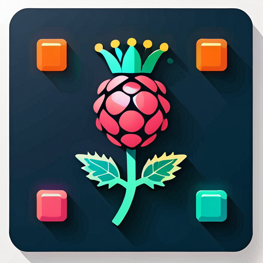

# Pish — Pi Shell



> A widget host for Raspberry Pi touch screens, written in Rust with [egui](https://github.com/emilk/egui).

Pish is a lightweight, iPad-style widget framework that runs on a Pi 5 + 7" touch display. Widgets are compiled in statically and rendered in a customisable grid. The first widgets are a digital clock, the [Nakostat](https://github.com/nakomis/nakostat) thermostat dial, and a BootBoots cat-camera slideshow.

---

## Support

If you find Pish useful, a small donation is very welcome:

[](https://www.paypal.com/donate?hosted_button_id=Q3BESC73EWVNN&custom=pish)

---

## Widgets

| Widget | Description |
|--------|-------------|
| `clock` | Digital clock and date, drawn from a shared `Services` struct |
| `nakostat` | Thermostat rotary dial with MQTT setpoint (depends on `rotary-dial`) and live readings from the sensor daemon |
| `bootboots` | Cat-camera slideshow — Mu → Tau → Chi → Kappa, tap to advance |

## Repo layout

```
pish/
├── pish-core/        PishWidget trait, Services (WiFi, clock, brightness, MQTT), config
├── pish-shell/       eframe app — home screen grid, widget lifecycle
├── widgets/
│   ├── clock/
│   ├── nakostat/
│   └── bootboots/
├── githooks/         Git hooks (drawio→svg, README TOC)
└── scripts/          Helper scripts
```

## Running locally (macOS smoke test)

`eframe` runs natively on macOS. To see the full widget grid before deploying to the Pi:

```bash
./scripts/run-local.sh
# or directly:
cargo run
```

## Deploying to the Pi

Cross-compile and copy the binary:

```bash
./scripts/build-pi.sh
./scripts/deploy-pi.sh
```

Pish runs as a systemd service (`pish.service`) inside [cage](https://github.com/cage-kiosk/cage), a minimal Wayland kiosk compositor. It starts automatically on boot.

## Configuration

Pish reads `/etc/pish/pish.toml` (override with `--config <path>` or `PISH_CONFIG`). See [`pish.toml.example`](pish.toml.example). A missing file is fine — pish runs without MQTT, which is what you want for the macOS smoke test.

Every value can be overridden from the environment:

| Variable | Overrides |
|----------|-----------|
| `PISH_MQTT_ENDPOINT` | `mqtt.endpoint` |
| `PISH_MQTT_PORT` | `mqtt.port` |
| `PISH_MQTT_CLIENT_ID` | `mqtt.client_id` |
| `PISH_MQTT_CERT_PATH` | `mqtt.cert_path` |
| `PISH_MQTT_KEY_PATH` | `mqtt.key_path` |
| `PISH_NAKOSTAT_SETPOINT_TOPIC` | `nakostat.setpoint_topic` |

### Nakostat setpoint over MQTT

When the thermostat dial settles (finger lifted and unchanged for 1.5 s) the widget publishes once to [Nakostat](https://github.com/nakomis/nakostat)'s AWS IoT Core broker over mutual TLS:

- **Topic:** `nakostat/<env>/pish/setpoint`
- **Payload:** `{"temperature": 21.5, "timestamp": "2026-10-13T07:30:00.000Z", "userId": "nakostat-pish-prod"}` — the same schema the Nakostat setpoint API publishes on `nakostat/<env>/api/setpoint`, with `userId` set to the display's thing name.

The IoT thing (`nakostat-pish-<env>`), its policy, certificate and the topic rule that applies the setpoint are defined in Nakostat's CDK (`infra/lib/iot-stack.ts`, `infra/lib/iot-rules-stack.ts`). The certificate and private key land in SSM Parameter Store when that stack is deployed. To install them on the Pi:

```bash
ENV=prod   # or sandbox
aws ssm get-parameter --name /nakostat/$ENV/pish/certPem --with-decryption \
  --query Parameter.Value --output text > cert.pem
aws ssm get-parameter --name /nakostat/$ENV/pish/privKey --with-decryption \
  --query Parameter.Value --output text > key.pem
ssh pish 'sudo install -d -m 700 /etc/pish/certs'
scp cert.pem key.pem pish.toml.example pish:/tmp/
ssh pish 'sudo install -m 600 /tmp/cert.pem /tmp/key.pem /etc/pish/certs/ \
  && sudo install -m 644 /tmp/pish.toml.example /etc/pish/pish.toml \
  && rm /tmp/cert.pem /tmp/key.pem /tmp/pish.toml.example'
shred -u cert.pem key.pem
# then edit /etc/pish/pish.toml: endpoint (`aws iot describe-endpoint --endpoint-type iot:Data-ATS`),
# client_id and setpoint_topic for $ENV, and `sudo systemctl restart pish`.
```

## Connecting via VNC

[wayvnc](https://github.com/any1/wayvnc) is installed and enabled as a systemd service (`wayvnc.service`). It attaches to cage's Wayland session automatically after `pish.service` starts.

To connect, open RealVNC Viewer and connect to `pish.local` (port 5900). You will be prompted for the Pi login password.

No manual steps are needed after a reboot — both `pish.service` and `wayvnc.service` start automatically.

## Sensor readings

The Nakostat widget shows live temperature, humidity, eCO₂ and TVOC from nakostat's sensor daemon, which runs on the same Pi and streams newline-delimited JSON over a Unix socket. Pish is a read-only client of that socket:

- Socket path defaults to `/run/nakostat/sensor.sock`; override it with `NAKOSTAT_SOCKET_PATH` (the same variable the daemon honours), e.g. `Environment=NAKOSTAT_SOCKET_PATH=...` in `pish.service`.
- If the daemon isn't running the widget shows **No sensor daemon** and retries with exponential backoff (0.5 s doubling to a 30 s cap), reconnecting automatically once the socket appears.
- A **warming up** badge is shown whilst the ENS160 is still settling after a cold start.

For the macOS smoke test there is normally no daemon, so the widget will sit in the "No sensor daemon" state.

## Building

```bash
cargo build --release
```

Cross-compile for Pi (aarch64):

```bash
cargo build --release --target aarch64-unknown-linux-gnu
```

## Testing

```bash
cargo test --workspace
cargo llvm-cov --workspace   # coverage report
```

CI requires ≥ 70 % line coverage.

## Adding a widget

1. `cargo new --lib widgets/<name>`
2. Add `pish-core = { workspace = true }` to its `Cargo.toml`.
3. Implement `PishWidget`.
4. Register it in `pish-shell/src/shell.rs`.
5. Add the new crate to the workspace `members` list.

## Licence

[CC0 1.0 Universal](LICENSE) — public domain dedication.

---

## Support

[](https://www.paypal.com/donate?hosted_button_id=Q3BESC73EWVNN&custom=pish)
